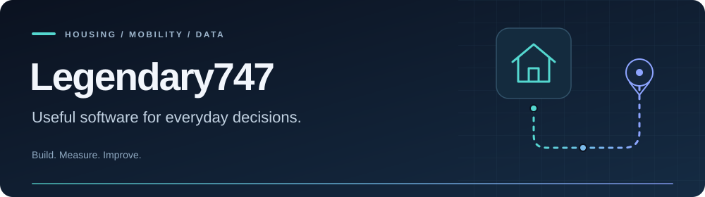

  

  <a href="#featured-projects">Featured projects</a> ·
  <a href="#research--engineering">Research &amp; engineering</a> ·
  <a href="https://github.com/Legendary747?tab=repositories">All repositories</a>

I build tools for problems I run into myself: keeping up with rental listings, understanding commute times, and making experiments easier to evaluate.

My work combines **practical software development** with an interest in **machine learning, language models, and evaluation**.

## Featured projects

<table>
<tr>
<td width="50%" valign="top">

### 🏠 H2S
**Housing search assistant**

Spend less time watching a rental-listing page. H2S runs in your browser and sends Telegram notifications when visible listings match your preferences.

- Configurable cities, rent budget, hours and refresh interval
- Persistent notification history and retry handling
- Manual verification; no automatic booking or Cloudflare bypass

**JavaScript · Tampermonkey · Telegram**

[Explore the project →](https://github.com/Legendary747/H2S)  
[Read the v1.4.0 release notes](https://github.com/Legendary747/H2S/releases/tag/v1.4.0)

</td>
<td width="50%" valign="top">

### 🛣️ Travel Time Analyser
**Understand your commute**

Collect traffic-aware Google Routes estimates over time, then compare typical journey times, delays and variability in charts and reports.

- Your own API key and origin/destination
- Scheduled observations with a local request ceiling
- Local SQLite storage; optional Google Cloud collection

**Python · Google Routes · SQLite · Google Cloud**

[Explore the project →](https://github.com/Legendary747/traveltime-work)  
[Setup and documentation](https://github.com/Legendary747/traveltime-work#readme)

</td>
</tr>
</table>

## Research & engineering

I also work on model evaluation and reproducible experiments. Public examples include [natural-language-inference control experiments](https://github.com/Legendary747/funMDL-toy) and [Dutch speech-recognition evaluation with Whisper and MMS](https://github.com/Legendary747/CSE3000).

  
  
  
  
  
  

---

Have a reproducible bug or an improvement in mind? Open an issue in the relevant project. Please keep API keys, private addresses and personal data out of public reports.
